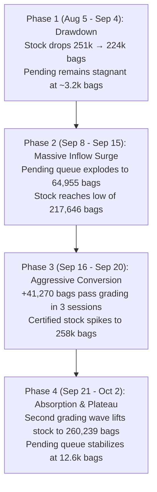

# ICE Coffee 'C' Certified Stocks & Pending Grading Pipeline Analysis


## Executive Summary

Across the 42 daily ICE Coffee "C" stock reports in [`data/fundamentals/ice_cert_stock/`](file:///Users/qm/Documents/KCquant/data/fundamentals/ice_cert_stock) spanning **August 5, 2026 to October 2, 2026**, certified warehouse inventory underwent a dramatic structural pivot from steady multi-week depletion to an aggressive accumulation wave driven by Brazilian tender deliveries into European ports.

| Metric | Starting Level (Aug 5) | Cycle Low (Sep 15) | Cycle High (Sep 30) | Latest (Oct 2) | Net Period Delta |
| :--- | :--- | :--- | :--- | :--- | :--- |
| **Certified Stocks (60-kg bags)** | 251,417 | 217,646 | 260,654 | **260,239** | **+8,822 (+3.5%)** |
| **Pending for Grading (bags)** | 3,250 | 64,955 *(Peak: Sep 11)* | 12,202 | **12,646** | **+9,396 (+289%)** |
| **Total Pipeline (Cert + Pending)** | 254,667 | 282,601 | 272,856 | **272,885** | **+18,218 (+7.2%)** |
| **Cumulative Passed Grading** | — | 1,922 | 64,083 | **64,083** | **+64,083 bags** |
| **Cumulative Failed Grading** | — | 6,823 | 31,369 | **31,369** | **+31,369 bags** |
| **Overall Grading Pass Rate** | — | — | — | **67.1%** | *(2 out of 3 pass)* |

---

## Trend Evolution & Phase Breakdown



### 1. Phase 1: Persistent Drawdowns (August 5 – September 4)
- **Certified Stocks:** Trended downward steadily from 251,417 to 223,712 bags (**-27,705 bags / -11.0%**), losing an average of ~1,200 bags per trading session to decertification, aging penalties, and physical roaster removals.
- **Pending Grading Queue:** Quiescent, averaging only 3,365 bags and bottoming at 640 bags on August 27. There was essentially no supply cushion behind existing stocks.

### 2. Phase 2: The Pending Queue Explosion (September 8 – September 15)
- **Pending Grading Queue:** Over just 4 trading sessions, pending volume expanded exponentially:
  - Sep 4: 3,205 bags
  - Sep 8: 16,997 bags
  - Sep 9: 55,270 bags
  - Sep 11: **64,955 bags (Cycle Peak)**
- **Certified Stocks:** Reached their absolute trough on **September 15 at 217,646 bags** (**-33,771 bags / -13.4%** from August 5).
- **Physical Dynamics:** The surge represented massive physical tender interest, equivalent to nearly **30% of total certified inventory** suddenly queued for grading.

### 3. Phase 3: The Rapid Certification Squeeze (September 16 – September 20)
- As ICE graders worked through the backlog, certified stocks experienced one of the sharpest multi-day inflows of the year:
  - **Sep 16:** +16,210 bags passed / +2,960 failed $\rightarrow$ Stock: 233,479 bags (+15,833 net)
  - **Sep 17:** +14,532 bags passed / +5,715 failed $\rightarrow$ Stock: 247,887 bags (+14,408 net)
  - **Sep 18:** +10,528 bags passed / +2,462 failed $\rightarrow$ Stock: 258,415 bags (+10,528 net)
- In just 3 days, **+41,270 bags were certified**, shifting net certified inventory back above early August levels in less than 72 hours.

### 4. Phase 4: Secondary Wave & Plateau (September 21 – October 2)
- A secondary wave of grading occurred on Sep 29 (+6,885 passed) and Sep 30 (+7,315 passed), pushing certified stock to a fresh high of **260,654 bags** before closing at **260,239 bags** on October 2.
- Pending grading settled back to **12,646 bags**, still ~4x the August baseline, providing an ongoing pipeline of potential certifiable supply.

---

## Origin & Port Intelligence

A drill-down into report line items (`with_detail=True`) reveals the physical origin and port destinations driving this supply cycle:

- **Origin Dominance:**
  - **Brazil** accounted for **669,397 total pending lot entries** and **62,149 passed bags (97.0% of all passed coffee)**.
  - Minor contributions came from Burundi (640 bags passed), Kenya (960 bags), and Uganda (334 bags).
- **Port Concentration:**
  - **Antwerp (ANT)** received **665,727 lot entries (>95%)** of the pending coffee queue, with modest amounts in New Orleans (NOLA) and New York (NY).
  - This confirms that European warehouses absorbed the brunt of Brazilian conillon/arabica tender deliveries against ICE benchmark contracts.

---

## Market Direction & Quantitative Takeaways

> [!IMPORTANT]
> **Directional Assessment: From Structural Deficit to Supply Relief**
> 1. **Pending Queue is a Direct 3-to-7 Day Leading Indicator:** The pending surge between Sep 8 and Sep 15 cleanly anticipated the bottom in certified stocks by 5 business days and forecasted the +42.6k bag rally before it registered on exchange inventory tickers.
> 2. **Pass Rate Stability:** The grading pass rate has averaged **67.1%** (64k passed vs 31k failed). With 12,646 bags still pending on Oct 2, expected upcoming additions to certified stock stand at approximately **+8,000 to +8,500 bags**, assuming steady rejection rates.
> 3. **Spread & Curve Impact:** The replenishment of certified stocks from the critical 217k bag danger zone back up to 260k+ bags dampens prompt tightness and backwardation pressures on nearby KC calendar spreads (N/U and U/Z), creating a natural cap on extreme prompt scarcity premiums.

---

## Re-running the Analysis

The automated script used to parse all 42 daily reports and render the visualization is available at [`scripts/plot_cert_stocks.py`](file:///Users/qm/Documents/KCquant/scripts/plot_cert_stocks.py).

To regenerate the chart or update with future reports:
```bash
PYTHONPATH=src python3 scripts/plot_cert_stocks.py
```
Outputs are saved directly to [`output/ice_cert_stock_trend.png`](file:///Users/qm/Documents/KCquant/output/ice_cert_stock_trend.png).
