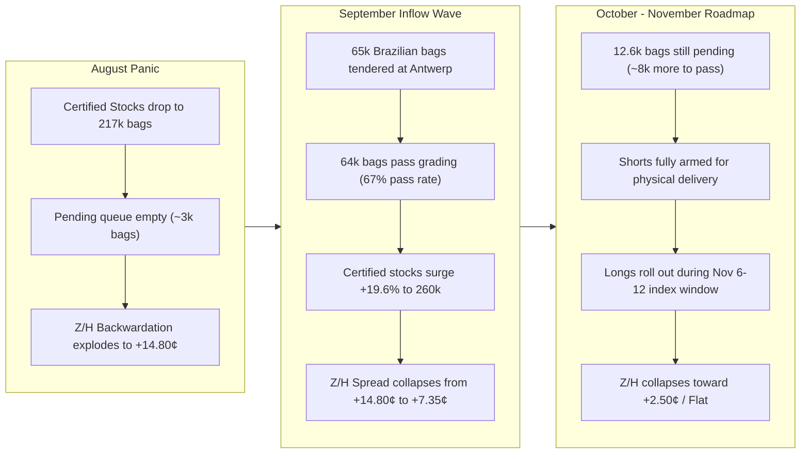

# KC Coffee 'C' Z/H Spread Strategy Assessment (Z26 vs H27)


## 1. Executive Summary & Strategy Stance

> [!IMPORTANT]
> **Recommended Strategy: Bear Spread (Short KCZ26 / Long KCH27)**  
> **Core Premise:** The rapid replenishment of certified stocks (+42.6k bags / +19.6% to 260,239 bags) and an additional 12.6k bags in the grading pipeline have permanently defused the physical delivery squeeze that drove the Z/H backwardation to +14.80¢ in August. With 34 business days until First Notice Day (Nov 19, 2026), trade shorts hold ample deliverable stocks, leaving prompt speculative longs vulnerable into the November index roll window.

| Trade Parameter | Level / Value | Contract Equivalent ($) | Rationale |
| :--- | :--- | :--- | :--- |
| **Current Spread (Z26 - H27)** | **+8.25¢** | **+$3,093.75** | Inverted / Backwardated prompt curve |
| **Recommended Action** | **Sell KCZ26 / Buy KCH27** | 1:1 Calendar Spread | Bear flattener / carry restoration trade |
| **Optimal Entry Range** | **+8.00¢ to +8.50¢** | +$3,000 to +$3,188 | Current consolidation plateau |
| **Target 1 (Base Case)** | **+2.50¢** | +$937.50 | Mean backwardation compression (+5.75¢ gain / **+$2,156/ct**) |
| **Target 2 (Delivery Squeeze Unwind)** | **0.00¢ to -1.00¢** | $0 to -$375 | Full carry / contango into FND (+8.25¢ to +9.25¢ gain / **+$3,094 to $3,469/ct**) |
| **Stop Loss (Invalidation)** | **+10.50¢** | +$3,937.50 | Breakout above post-spike resistance (-2.25¢ risk / **-$844/ct**) |
| **Risk / Reward Ratio** | **~2.6 : 1 (T1) / 3.7 : 1 (T2)** | — | Highly asymmetric fundamental edge |

---

## 2. Fundamental Inventory Linkage to the Z/H Spread

The Z/H spread (December vs. March) is the single most sensitive barometer of physical warehouse tightness on the ICE Coffee "C" curve.



### Key Quantitative Findings:
1. **The August Inversion Spike (+14.80¢):** When certified stocks eroded to multi-month lows (217,646 bags on Sep 15), prompt sellers were caught with minimal physical backing. The backwardation widened to a peak of **+14.80¢/lb** ($5,550/contract premium on Dec over Mar).
2. **The September Supply Response (+42.6k bags):** Favorable tender parity prompted massive shipments of Brazilian semi-washed coffee into Antwerp. Once grading began on Sep 16, **41.3k bags passed in just 3 sessions**, and the Z/H spread broke down immediately from +12.20¢ to **+7.35¢**.
3. **The Current Consolidation (+8.25¢):** Over the past 10 sessions, the spread has stabilized between +7.60¢ and +8.65¢. This pause is temporary: graders are processing the final **12,646 bags** currently pending. Assuming the prevailing 67.1% pass rate, another **~8,500 bags** will be added to certified inventory by mid-October, raising deliverable stocks to **~268k–270k bags**.

---

## 3. Historical Precedent: The 2022 Analogy

A study of past ICE Coffee "C" Z/H cycles in [`output/KC_databento_fixed_raw_curve.csv`](file:///Users/qm/Documents/KCquant/output/KC_databento_fixed_raw_curve.csv) shows that current market conditions closely mirror **October 2022**:

| Year | Early October Z/H Spread | FND Spread (Mid-Nov) | Expiry Spread (Mid-Dec) | Change Oct $\rightarrow$ FND | Inventory Context |
| :--- | :--- | :--- | :--- | :--- | :--- |
| **2019** | -3.60¢ | -1.25¢ | -1.45¢ | +2.35¢ | Abundant stocks (>2M bags), contango carry market |
| **2020** | -2.15¢ | -2.55¢ | -1.55¢ | -0.40¢ | Steady stocks, normal carry |
| **2021** | -2.85¢ | -0.10¢ | +0.10¢ | +2.75¢ | Tightening stocks, transition toward flat |
| **2022** | **+8.40¢** | **-3.80¢** | **-0.25¢** | **-12.20¢** | **Late summer tender influx replenished stocks; backwardation collapsed into contango** |
| **2023** | -1.00¢ | +6.75¢ | +12.50¢ | +7.75¢ | Stock depletion late in the year squeezed prompt |
| **2024** | +2.00¢ | +2.80¢ | +1.35¢ | +0.80¢ | Balanced physical pipeline |
| **2025** | +15.85¢ | +29.85¢ | +27.40¢ | +14.00¢ | Severe structural stock drought; zero pending coffee |
| **2026 (Now)** | **+8.65¢ / +8.25¢** | *Nov 19, 2026* | *Dec 18, 2026* | *Projected: -5.75¢ to -8.25¢* | **High pending influx, stocks rebounding +19.6% $\rightarrow$ Analogy to 2022** |

> [!TIP]
> In **October 2022**, the Z/H spread stood at **+8.40¢**—almost identical to today's **+8.25¢**. As physical certified stocks arrived in warehouses and index funds rolled, the spread **collapsed by 12.20¢ to -3.80¢ contango** by First Notice Day.

---

## 4. Contract Timeline & Operational Catalysts

```
Today (Oct 05)                Nov 06 - 12               Nov 19                Dec 18
      |----------------------------|-----------------------|---------------------|
   Current                   Passive Index            First Notice           Last Trading
  Inventory                  Fund Roll Window           Day (FND)             Day (LTD)
Replenishment               (Longs forced out)     (Shorts tender certs)     (Contract expires)
```

1. **Catalyst 1: Final Grading Backlog Clearance (October 5 – 16)**
   - ICE publishes daily certified updates. The clearance of the remaining 12.6k pending bags will push certified warehouse inventory near 270,000 bags.
2. **Catalyst 2: Commodity Index Roll Pressure (November 6 – 12)**
   - Passive commodity benchmarks (BCOM, S&P GSCI) hold extensive long positions in KCZ26. Because they cannot accept physical delivery, they must mechanically sell Z26 and buy H27 across the 5-day roll window.
3. **Catalyst 3: First Notice Day Delivery Threat (November 19)**
   - Speculative longs remaining in KCZ26 by Nov 19 face delivery tenders from commercials holding Antwerp warehouse receipts. To avoid taking physical coffee and financing storage, remaining longs will dump prompt contracts at any price, forcing prompt compression.

---

## 5. Trade Structuring & Risk Management

### Execution Details
- **Instrument:** ICE Coffee "C" Calendar Spread (KCZ26 - KCH27)
- **Position:** Short 1 contract KCZ26 / Long 1 contract KCH27
- **Current Margin:** ICE exchange calendar spread margin is significantly lower than outright futures (typically ~$500–$800 vs. ~$5,000+ for outrights), giving superior capital efficiency.
- **Entry:** Scale in between **+8.00¢ and +8.50¢**.
- **Exit Strategy:**
  - **Take Profit 1 (+2.50¢):** Cover 50% of position during the early November index roll window (+5.75¢ / +$2,156 profit per spread).
  - **Take Profit 2 (Flat / 0.00¢):** Trail remaining 50% into First Notice Day (Nov 19) for full delivery pressure (+8.25¢ / +$3,094 profit per spread).
- **Risk Invalidation / Stop Loss:** Hard stop at **+10.50¢** on a closing basis. A close above 10.50¢ would invalidate the thesis and indicate unexpected massive roaster withdrawals or Brazilian port disruptions.
